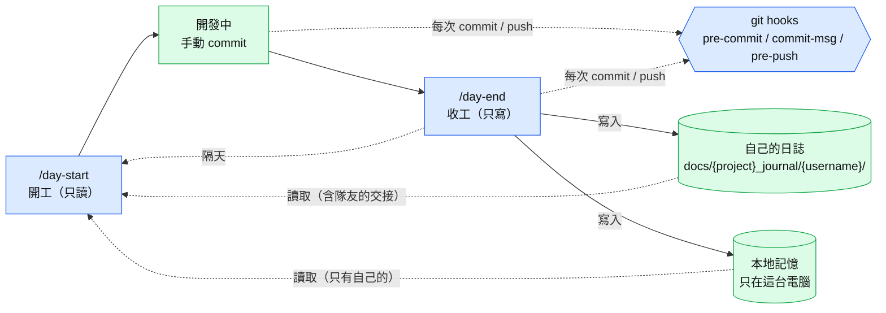
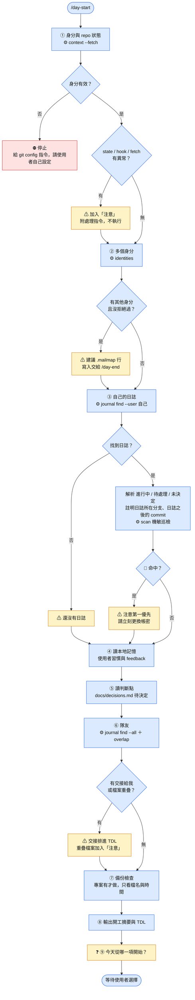
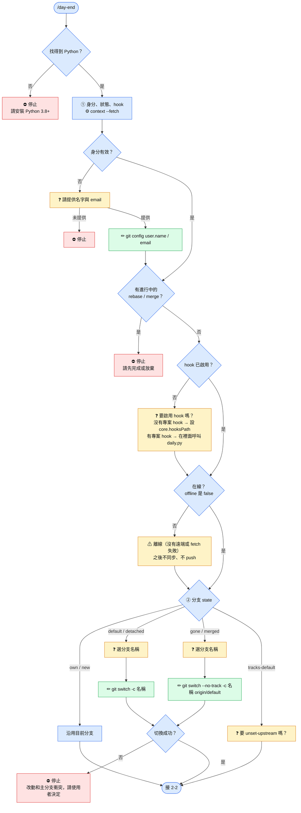
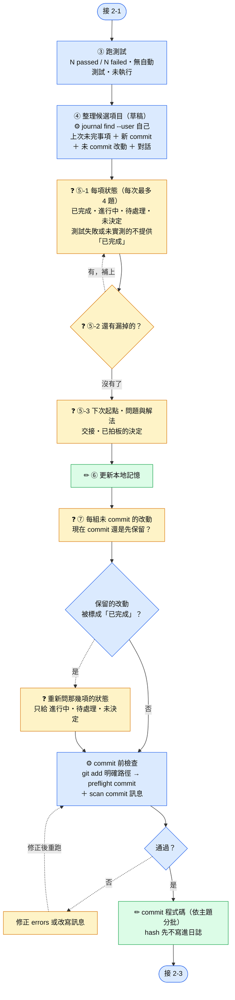
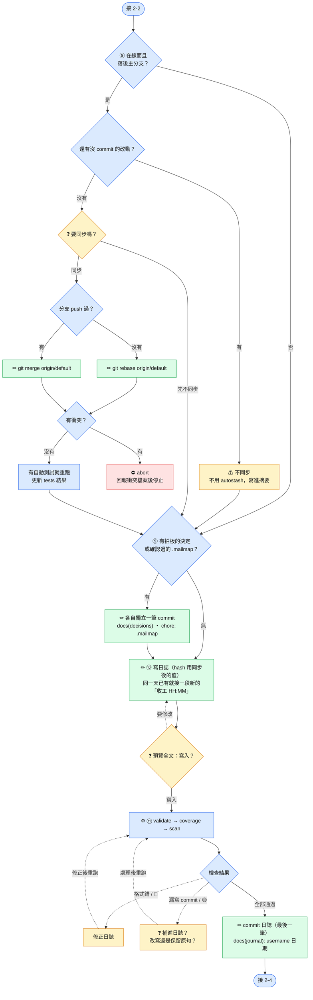
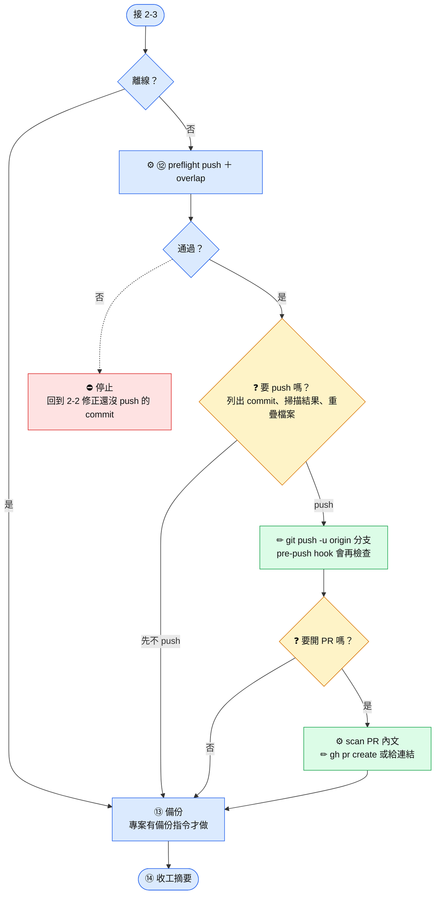
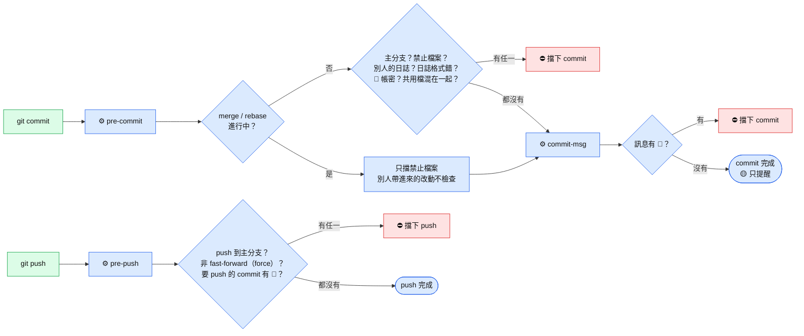

# Day Start / Day End 流程圖（工程版）

`/day-start`（開工，只讀）與 `/day-end`（收工，只寫）的完整流程，包含 `daily.py` 子命令、`context` 欄位、git 指令與每一個分支狀況。給維護 skill、排查問題的人看；一般使用者請看 [使用者版](day-flow-user.md)。
規則細節見 [day-start/SKILL.md](day-start/SKILL.md)、[day-end/SKILL.md](day-end/SKILL.md)、[_daily/git-workflow.md](_daily/git-workflow.md)。

## 圖例

| 顏色 | 代表 | 標記 |
|---|---|---|
| 🟦 藍 | 系統自動處理：步驟、判斷、`daily.py` 檢查 | ①② ⚙ ◇ |
| 🟨 黃 | 需要使用者：回答問題（❓），或放進摘要的提醒（⚠，流程繼續） | ❓ ⚠ |
| 🟩 綠 | 寫入：檔案、git config、commit、push | ✏ |
| 🟥 紅 | 停止，等使用者處理 | ⛔ |

| 線條 | 意思 |
|---|---|
| 實線 → | 正常往下走 |
| 虛線 ⇢ | 有錯誤或要修改，回到前面重做 |

---

## 0. 總覽

> 總覽裡的虛線表示「隔天 / 每次觸發 / 讀取」，不是錯誤回頭；其他圖的虛線都是錯誤回頭。

---

## 1. /day-start（只讀）

### 第 ① 步可能的狀況

| 狀況（`context` 的欄位） | 放進「注意」的提醒 |
|---|---|
| `state: in-progress` | **第一優先**：有進行中的 rebase / merge / cherry-pick / revert，請先完成或放棄 |
| `state: default` / `detached` | 今天的工作要開分支 `git switch --no-track -c <username>/<主題> origin/<default>` |
| `state: gone` / `merged` | 分支已合併或遠端已刪除，從最新主分支開新分支 |
| `state: tracks-default` | upstream 指向主分支，`git branch --unset-upstream` |
| `hooks.enabled: false` | 沒有專案 hook → 設定 `core.hooksPath`；專案 hook 沒有三個都呼叫 `daily.py` → 建議補上呼叫 |
| `offline: true` | 沒有 remote → 略過隊友與遠端比對；`fetch: failed` → 離線，遠端比對都標「未更新」 |

---

## 2. /day-end（只寫）

流程比較長，分成四段。收工的 commit 順序固定為：**程式碼 → 同步主分支 → 判斷點 / `.mailmap` → 日誌（最後一筆）**。先同步再寫日誌，rebase 改掉的 hash 才不會讓日誌失效。

### 2-1 前置檢查與分支

### 2-2 問卷與 commit 程式碼

### 2-3 同步主分支、共用檔與日誌

### 2-4 push 與收尾

---

## 3. Git hooks（手動 commit / push 也會檢查）

> 被擋下時照錯誤訊息修正，**不要用 `--no-verify` 繞過**。沒有啟用 hook 時，`/day-end` 每次 commit 前會手動跑同樣的檢查（`preflight commit` ＋ 掃 commit 訊息）。沒衝突、自動完成的 `git merge` 不會經過 pre-commit；在主分支上 merge 的結果會在 push 時被 pre-push 擋下。

---

## 4. 所有停止點（⛔）一覽

| 在哪 | 狀況 | 使用者要做的事 |
|---|---|---|
| day-start ① | git 身分未設定，或是電腦自動產生的 email | 自己執行 `git config user.name / user.email` |
| day-end 開頭 | 找不到 Python | 安裝 Python 3.8+ |
| day-end ① | 不提供名字或 email | 提供後重跑 |
| day-end ① | 有進行中的 rebase / merge | 完成（`--continue`）或放棄（`--abort`） |
| day-end ② | 開新分支時，改動和主分支衝突 | 決定怎麼處理改動（例如自己 stash） |
| day-end ⑧ | 同步主分支時有衝突（已自動 abort） | 手動解衝突，或這次先不同步 |
| day-end ⑫ | 要 push 的 commit 有 🔴 或違反規則 | 修正還沒 push 的 commit 後重跑 |
| hook | commit / push 被擋 | 照錯誤訊息修正 |
