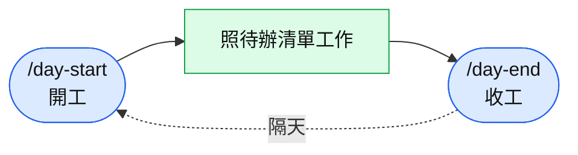
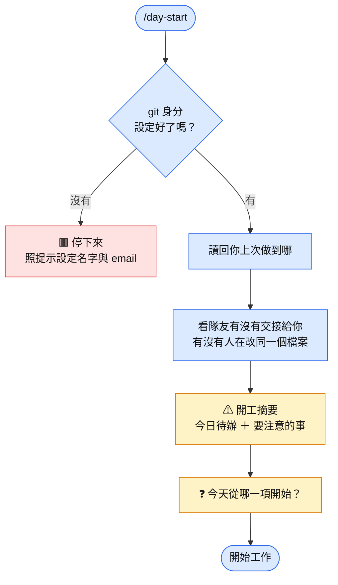
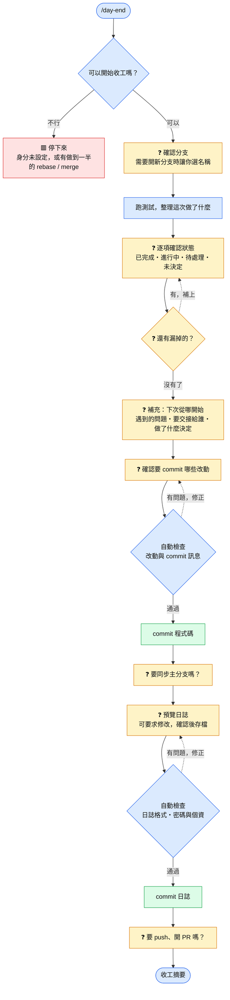

# 開工 / 收工 怎麼用（使用者版）

每天開始打 `/day-start`，結束打 `/day-end`。大部分檢查 Claude 會自動做，你只需要在**黃色**的地方回答問題。
想看完整的技術細節，請看 [工程版](day-flow-dev.md)。

| 顏色 | 意思 |
|---|---|
| 🟦 藍 | Claude 自動處理，你不用做事 |
| 🟨 黃 | 輪到你：回答問題，或看一下提醒 |
| 🟩 綠 | 會存檔或送出（日誌、commit、push） |
| 🟥 紅 | 停下來，要你先處理 |

| 線條 | 意思 |
|---|---|
| 實線 → | 正常往下走 |
| 虛線 ⇢ | 有錯誤或要修改，回到前面重做 |

---

## 一天的流程

---

## 開工 `/day-start`

只會讀資料，**不會改動任何東西**。

**摘要裡可能出現的提醒**（看到再照著做就好）：

- 你在主分支上，或分支已經合併 → 建議開新分支（附指令）
- 有做到一半的 rebase / merge → 先完成或放棄
- 隊友交接了事情給你 → 已排進待辦
- 隊友也在改同一個檔案 → 動手前先和對方確認
- 日誌裡疑似有密碼或個資 → 照提示處理

---

## 收工 `/day-end`

**你會被問到的問題**：

| 問題 | 怎麼回答 |
|---|---|
| 每一項工作的狀態 | 從四個選項選一個；項目寫得不對可以在「Other」改寫，或說「刪除」 |
| 還有沒列到的工作嗎 | 有就在「Other」補上項目與狀態 |
| 下次從哪開始、問題與解法、交接、決定 | 從選項選，或自己寫；沒有就選「無」 |
| commit / 同步 / push / 開 PR | 不同意的話 Claude 就不會做 |

**沒選「已完成」，就不會被記成完成。** 測試沒過的項目，選項裡不會出現「已完成」；選了「先保留不 commit」的改動，如果之前標成「已完成」，會再問一次狀態。

沒有遠端（或連不上）時，收工只會在本機 commit，跳過同步與 push。

---

## 什麼時候會停下來

| 狀況 | 你要做的事 |
|---|---|
| git 身分沒設定 | 提供名字與 email |
| 電腦沒有 Python | 安裝 Python 3.8 以上 |
| 有做到一半的 rebase / merge | 完成或放棄後再執行一次 |
| 同步主分支時有衝突 | Claude 已經還原，請自己解衝突，或這次先不同步 |
| 內容疑似有密碼或金鑰 | 照提示改寫；密碼已經 push 出去的話，請立刻更換 |
| commit 或 push 被擋下 | 看錯誤訊息修正（例如不能在主分支 commit、不能改別人的日誌） |
